# RaceProof System Architecture

> **Version**: 1.0  
> **Status**: Production Standard  
> **Target**: Comprehensive engineering design of the 7-stage deterministic verification pipeline.

---

## 1. High-Level Architecture

RaceProof is a verification-first differential concurrency analysis and formal proof engine. It operates downstream of security testing tools, transforming raw concurrent HTTP response bursts into mathematically verified, signed findings.

```mermaid
flowchart TD
    subgraph Ingestion["1. Ingestion Layer"]
        A1["Burp Suite XML"]
        A2["Turbo Intruder JSON"]
        A3["HTTP Archive (.har)"]
        A4["mitmproxy (.flow / json)"]
        A5["Postman / Newman"]
        A6["k6 NDJSON"]
        A7["OpenTelemetry Traces"]
        A8["WebSocket Frames"]
    end

    subgraph Adapters["2. Adapter & Normalization"]
        AD["Auto-Detect & Schema Normalizer"]
        RS["RaceSession Model (RFC-7230 / ISO-8601)"]
    end

    subgraph Core["3. Deterministic Rust & Analysis Pipeline"]
        R1["Rust SIMD Myers & Token Differ"]
        R2["SimHash & MinHash LSH Clustering"]
        R3["ReqRacer Sweep-Line Happens-Before DAG"]
        R4["Wilson 95% Confidence & Binomial p-values"]
        R5["Latent Business Invariant Miner"]
    end

    subgraph FormalSwarm["4. Formal Prover & Multi-Agent Swarm"]
        TLA["TLA+ Specification Generator (WebApiRaceModel.tla)"]
        BFS["State-Space BFS Interleaving Explorer"]
        ADV["Adversary Skeptic Agent (Noise & Rate-Limit Check)"]
        PRV["Formal Verification Agent"]
        REM["Remediation & Database Isolation Agent"]
        CS["Bayesian Anti-Hallucination Consensus"]
    end

    subgraph Evidence["5. Packaging & Standards Output"]
        VB["Verdict Bundle (CONFIRMED / BENIGN / UNCERTAIN)"]
        S21["SARIF 2.1.0 Static Analysis"]
        INTO["in-toto Statement v1.0 + Ed25519 Attestation"]
        HTML["Standalone Interactive diff.html Dashboard"]
        POC["asyncio.Barrier Python Reproduction PoC"]
    end

    Ingestion --> AD
    AD --> RS
    RS --> Core
    Core --> FormalSwarm
    FormalSwarm --> Evidence
```

---

## 2. Ingestion & Normalization Layer

Every tool export is normalized into a uniform Pydantic model:
- `RaceRequest`: URL, method, headers, payload, timestamp.
- `RaceResponse`: Status code, headers, body, elapsed latency, time-to-first-byte (TTFB), request metadata.
- `RaceSession`: Baseline single-request response, list of concurrent race responses, session identifier, source tool metadata.

---

## 3. The 7 Deterministic Analysis Dimensions

The core analysis engine executes seven orthogonal dimensions:

1. **Status Code Invariance**: Verifies distribution of 2xx, 4xx, and 5xx responses.
2. **Semantic Body Diffing**: Token-level Myers/Patience diffing after auto-masking ephemeral fields (CSRF tokens, UUIDs, timestamps, JWTs).
3. **Temporal Flight Analysis**: Computes exact server-side processing windows ($\Delta = \text{elapsed} - \text{TTFB}$).
4. **MinHash & Banded LSH Clustering**: Near-duplicate clustering across thousands of concurrent bodies ($B=32, R=4$).
5. **Business Invariant Evaluation**: JMESPath expressions and operators (`single_200_winner`, `any_negative`, `state_stall`, `unique`).
6. **Academic Concurrency Modeling**: ReqRacer happens-before relations ($\prec_{web}$) and PortSwigger state-machine cross-route collisions.
7. **Defect Classification**: Categorization into ANSI SQL / IEEE S&P anomalies (`LOST_UPDATE`, `TOCTOU_DIRTY_READ`, `WRITE_SKEW`, `LIMIT_OVERRUN`).

---

## 4. Formal Concurrency Verification Engine

RaceProof translates observed API sessions into formal TLA+ mathematical models:
- **`WebApiRaceModel.tla`**: Models concurrent threads, balance transitions, and invariant predicates (`NoOverdraft`, `SingleWinner`).
- **Counterexample Trace Generation**: If an execution schedule allows two threads to read uncommitted balance before committing, RaceProof outputs the exact step-by-step interleaving schedule.

---

## 5. Multi-Agent Anti-Hallucination Swarm

To guarantee zero hallucinations:
- Three specialized agents run in parallel:
  1. **Adversary Agent**: Attempts to debunk the finding as ephemeral noise, dynamic nonces, or rate-limiting.
  2. **Formal Prover Agent**: Evaluates state-space invariants.
  3. **Architect Agent**: Determines root-cause isolation level (`SERIALIZABLE`, `SELECT ... FOR UPDATE`).
- Verdicts are only confirmed when the Prover confirms invariant breach and the Adversary fails to debunk the finding.
